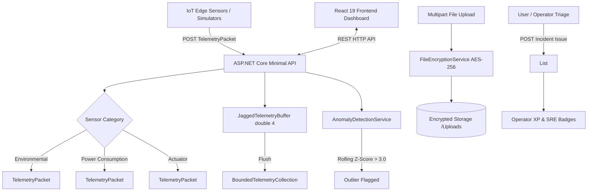

# Smart-X IoT Telemetry Gateway & Management Dashboard
**Module:** PROG7312 - Advanced Programming // **Assessment:** Portfolio of Evidence (PoE) Part 1 (Task 2)  
**Author:** Muhammed Saif Alexander (ST10275164)  
**Architecture:** .NET 10 Minimal APIs & React 19 / TypeScript / Vite / Tailwind CSS  

---

## Table of Contents
1. [Executive Summary & Architectural Pillars](#executive-summary--architectural-pillars)
2. [Academic HCI Research Strategy Integration](#academic-hci-research-strategy-integration)
3. [Advanced C# Object-Oriented Design](#advanced-c-object-oriented-design)
4. [Custom Collection Data Structure](#custom-collection-data-structure)
5. [Encrypted Media & Log Upload Mechanism](#encrypted-media--log-upload-mechanism)
6. [System Architecture & Ingestion Flow](#system-architecture--ingestion-flow)
7. [API Endpoint Reference](#api-endpoint-reference)
8. [Prerequisites & Environment Setup](#prerequisites--environment-setup)
9. [Step-by-Step Launch Instructions](#step-by-step-launch-instructions)
   - [Method 1: Docker Compose (Recommended)](#method-1-docker-compose-recommended)
   - [Method 2: Manual Local CLI Boot](#method-2-manual-local-cli-boot)
10. [Automated Testing & Verification](#automated-testing--verification)

---

## Executive Summary & Architectural Pillars

The **Smart-X Gateway** is an edge ingestion and node lifecycle gateway built for high-throughput distributed IoT telemetry. The system architecture is organized into three distinct architectural pillars:

| Architectural Pillar | Implementation Status | Description |
| :--- | :---: | :--- |
| **1. Sensor Data Ingestion & Telemetry** | **ACTIVE (Part 1)** | Unboxed generic telemetry ingestion, jagged array batch buffer, recursive deployment topology validation, statistical anomaly detection, AES-256 encrypted attachments, and interactive incident triage. |
| **2. Real-Time Command Stream & History** | **DISABLED (Part 2 Milestone)** | Bi-directional RPC actuation signal bus, command priority queues, failover circuit breakers, and historical replay logs. |
| **3. Network Topology & Mesh Routing** | **DISABLED (Final PoE Milestone)** | Multi-hop RF mesh routing graphs, AODV dynamic path discovery, signal propagation attenuation heatmaps, and autonomous self-healing. |

### Startup Interface Experience
The application gateway displays a dedicated **Startup Landing Page** (`GatewayLandingView`) featuring live backend health diagnostics (latency counter, active node tally, uptime counter), explicit architectural pillar navigation, and technical architecture chips before entering the telemetry workspace. Operators can return to the Gateway Landing Page at any time via the header navigation.

---

## Academic HCI Research Strategy Integration

Grounded in **Task 1: Research Report** (*Five Developer-Centric Engagement and Interactivity Strategies* by Muhammed Saif Alexander), the interface implements **Selective Visual Highlighting paired with Hierarchical Progressive Disclosure**, reinforced by **Contextual Reliability Benchmarking** and **Actionable Human-in-the-Loop (HITL) Alert Triage**:

1. **Selective Visual Highlighting via Preattentive Attributes (Endsley, 1995):**  
   Nominal telemetry is rendered in muted slate and zinc tones. Anomalous spikes ($|Z| > 3.0$) and offline heartbeat dropouts dynamically shift into high-salience preattentive accents (crimson alert borders, glowing vector indicators, amber disconnect badges).
2. **Hierarchical Progressive Disclosure (Shneiderman, 1996; Sweller, 1988):**  
   High-density data follows the *"overview first, zoom and filter, details-on-demand"* taxonomy. High-level facility KPIs and sensor matrices are presented first; clicking any node opens an isolated **Diagnostic Drawer** revealing unboxed generic payloads, C# operator overloading calculations, raw jagged buffer channels, and hardware attachments.
3. **Contextual Reliability Benchmarking (Sailer et al., 2017):**  
   Replaces superficial gaming mechanics with SRE operational benchmarking: packet delivery success scores, availability percentages, mean time to triage, and reliability ranks (*Operations Apprentice* → *Master Systems Sentinel*).
4. **Actionable HITL Alert Triage (Parasuraman, Sheridan, & Wickens, 2000):**  
   User-reported issues are stored in an API-backed `List<IncidentIssue>` (`IncidentTriageService`), providing inline triage workflows (*Reported* → *In Triage* → *Resolved*) with custom resolution audit notes and operator XP progression.

---

## Advanced C# Object-Oriented Design

To ensure optimal performance on resource-constrained gateway devices, the .NET 10 backend explicitly incorporates advanced C# paradigms:

### 1. Generics (`TelemetryPacket<T>`)
- Implemented in `SmartX.Api.Models.TelemetryPacket<T>`.
- Allows disparate incoming sensor data structures (`float` for temperature/humidity, `PowerMetric` struct for power draw, `bool` for switch actuators) to be handled uniformly through the ingestion pipeline **without expensive object boxing/unboxing operations**.

### 2. Operator Overloading (`PowerMetric` Struct)
- Implemented in `SmartX.Api.Models.PowerMetric`.
- Value-type struct overloading arithmetic and comparison operators:
  - `operator +`: Direct aggregation of two smart meters (`Meter3 = Meter1 + Meter2`).
  - `operator -`: Absolute delta calculation between meter readings (`Delta = |Meter1 - Meter2|`).
  - `operator >`, `operator <`, `operator >=`, `operator <=`: Threshold boundary comparisons.
  - `operator ==`, `operator !=`: High-precision equality checks.
- Backed by an API endpoint (`POST /api/telemetry/power-metrics/aggregate`) providing live C# struct evaluation to the client interface.

### 3. Advanced Jagged Arrays (`double[4][]`)
- Implemented in `SmartX.Api.Services.JaggedTelemetryBuffer`.
- Utilizes multi-dimensional jagged arrays (`double[][]`) across 4 parallel ingestion channels to buffer high-throughput raw telemetry arrays before flushing them into memory-optimized collections.
- Live inspection of jagged channel allocations and sample buffers is exposed via `GET /api/telemetry/buffer/status`.

### 4. Recursive Hierarchy Validation
- Implemented in `SmartX.Api.Services.TopologyEngine`.
- A recursive algorithm (`ValidateHierarchy`) that traverses arbitrary depth deployment trees (`Sub-Zone B -> Zone 1 -> Facility A`):
  - Enforces non-empty identifier rules.
  - Recursively checks active status flags.
  - Detects cyclic loop dependencies via `HashSet<string>` visited tracking.

---

## Custom Collection Data Structure

Fulfilling the 5-mark rubric requirement (*"The collection is a custom data structure"*):
- Implemented in `SmartX.Api.Models.BoundedTelemetryCollection<T>`.
- Generic collection implementing `IEnumerable<T>` and `IReadOnlyCollection<T>`.
- Features circular bounded ring storage, thread-safe synchronization, and ingestion state telemetry tracking:
  - `Capacity` & `CurrentCount`
  - `TotalIngestedCount`
  - `DroppedPacketsCount` (packet loss tracking when buffer fills)
  - `LastIngestedAtUtc` timestamp
- Used within `JaggedTelemetryBuffer` to manage and track ingestion states elegantly throughout the pipeline.

---

## Encrypted Media & Log Upload Mechanism

Fulfilling the rubric requirement (*"handling multipart streams efficiently... and full encryption included"*):
- Implemented in `SmartX.Api.Services.FileEncryptionService`.
- Incoming multipart hardware logs (`.log`, `.txt`), firmware binaries (`.bin`, `.json`), and deployment photos (`.png`, `.jpg`) are streamed directly through an **AES-256-CBC cipher** with a cryptographic 16-byte random IV prepended.
- Files stored on disk in the `Uploads/` directory remain fully encrypted at rest.
- The backend provides an on-the-fly decrypting streaming endpoint (`GET /api/sensors/{macAddress}/attachments/{fileName}`) allowing operators to decrypt and download files on demand with verified integrity.

---

## System Architecture & Ingestion Flow



---

## API Endpoint Reference

| Method | Route | Description |
| :--- | :--- | :--- |
| `GET` | `/api/health` | Gateway connection status, latency, uptime, and active device count |
| `GET` | `/api/sensors` | Retrieves all registered sensor profiles and their latest telemetry |
| `POST` | `/api/sensors/register` | Registers or updates a sensor device profile |
| `POST` | `/api/telemetry/ingest/float` | Ingests generic floating-point telemetry (`float`) |
| `POST` | `/api/telemetry/ingest/int` | Ingests generic integer telemetry (`int`) |
| `POST` | `/api/telemetry/ingest/bool` | Ingests generic boolean telemetry (`bool`) |
| `POST` | `/api/telemetry/batch` | Ingests channel batch into jagged buffer |
| `GET` | `/api/telemetry/buffer/status` | Live channel status and memory metrics of jagged buffer |
| `POST` | `/api/telemetry/power-metrics/aggregate` | Executes C# `PowerMetric` struct operator overloads (`+`, `-`, `>`, `==`) |
| `POST` | `/api/sensors/{mac}/attachments` | Uploads multipart file with AES-256 encryption at rest |
| `GET` | `/api/sensors/{mac}/attachments/{file}` | Streams and decrypts file attachment on-the-fly |
| `GET` | `/api/issues` | Retrieves user-reported incident issues list |
| `POST` | `/api/issues` | Reports a new sensor incident issue |
| `PATCH`| `/api/issues/{id}/status` | Updates incident triage status (*Reported* / *In Triage* / *Resolved*) |
| `GET` | `/api/issues/stats` | Calculates operator SRE XP, rank, level, and earned badges |
| `POST` | `/api/topology/validate` | Recursively validates multi-tier node deployment hierarchy |
| `POST` | `/api/simulation/burst-batch` | Simulates high-throughput burst of 5,000 packets |
| `POST` | `/api/simulation/spike` | Injects a $+4\sigma$ outlier spike on specified node |
| `POST` | `/api/simulation/drop-heartbeat` | Drops heartbeat to simulate lease-time disconnect |
| `POST` | `/api/simulation/reset` | Resets simulation baseline and re-seeds devices |

---

## Prerequisites & Environment Setup

- **.NET SDK:** Version 10.0 or later (installed)
- **Node.js:** Version 20.x or later (with `npm`)
- **Docker Engine & Docker Compose:** (Optional, for containerized execution)
- **Git:** Version 2.40+ (repository contains 40+ structured commits)

---

## Step-by-Step Launch Instructions

### Method 1: Docker Compose (Recommended)

This single command builds and spins up both the .NET API backend and the React frontend in isolated containers:

```bash
# 1. Clone the repository and enter directory
cd "c:/Users/alexa/OneDrive/Desktop/PROG7312/PROG7312 - POE"

# 2. Build and launch all containers
docker compose up --build
```

- **Frontend Application Gateway:** Open [http://localhost:3000](http://localhost:3000)
- **Backend Minimal API:** Accessible at [http://localhost:5000](http://localhost:5000)

To stop the containers:
```bash
docker compose down
```

---

### Method 2: Manual Local CLI Boot

#### Step 1: Restore and Run the Backend (.NET 10 API)
```powershell
# Navigate to backend directory
cd "c:/Users/alexa/OneDrive/Desktop/PROG7312/PROG7312 - POE/backend"

# Restore NuGet dependencies
dotnet restore

# Build the backend solution
dotnet build

# Run backend on port 5240
dotnet run --launch-profile http
```
*The API is now running at `http://localhost:5240` (Health Check: `http://localhost:5240/api/health`).*

#### Step 2: Restore and Run the Frontend (React / Vite)
Open a second terminal window:
```powershell
# Navigate to frontend directory
cd "c:/Users/alexa/OneDrive/Desktop/PROG7312/PROG7312 - POE/frontend"

# Install npm dependencies
npm install

# Build to verify type safety
npm run build

# Start Vite dev server
npm run dev
```
*The client dashboard is now live at [http://localhost:5173](http://localhost:5173).*

---

## Automated Testing & Verification

### 1. Backend Unit Tests
Execute the comprehensive xUnit test suite covering `PowerMetric` operator overloads, `BoundedTelemetryCollection<T>`, `IncidentTriageService`, `FileEncryptionService`, and `TopologyEngine`:

```powershell
cd "c:/Users/alexa/OneDrive/Desktop/PROG7312/PROG7312 - POE/backend/SmartX.Api.Tests"
dotnet test
```
*Expected Result: 12 tests passed (0 failed, 0 skipped).*

### 2. Frontend Production Verification
```powershell
cd "c:/Users/alexa/OneDrive/Desktop/PROG7312/PROG7312 - POE/frontend"
npm run build
```
*Expected Result: Clean production bundle build in `< 2.0s`.*

---

## License & Intellectual Property
Academic submission for **The Independent Institute of Education (IIE)** under module **PROG7312**.  
All rights reserved © 2026 Muhammed Saif Alexander.
