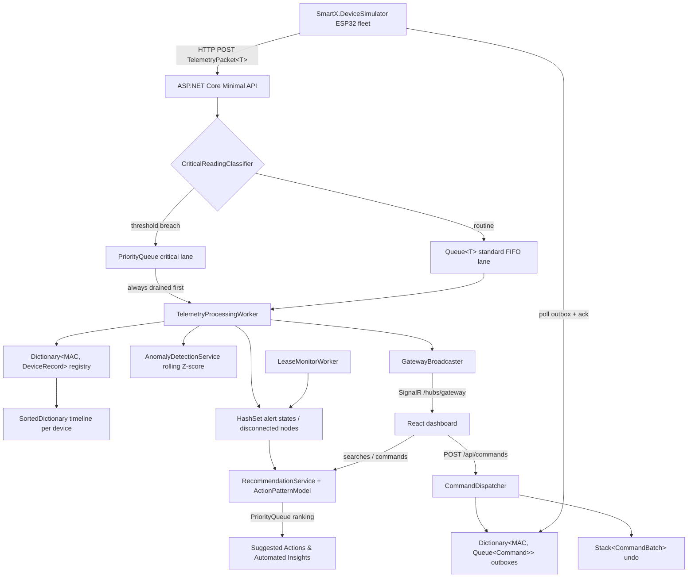

# Smart-X IoT Telemetry Gateway & Management Dashboard
**Module:** PROG7312 - Advanced Programming // **Assessment:** Portfolio of Evidence (PoE) Part 1 (Task 2) & Part 2  
**Author:** Muhammed Saif Alexander (ST10275164)  
**Architecture:** .NET 10 Minimal APIs + SignalR, .NET device simulator, React 19 / React Router / TypeScript / Vite / Tailwind CSS  

---

## Table of Contents
1. [Executive Summary & Architectural Pillars](#executive-summary--architectural-pillars)
2. [Academic HCI Research Strategy Integration](#academic-hci-research-strategy-integration)
3. [Advanced C# Object-Oriented Design](#advanced-c-object-oriented-design)
4. [Custom Collection Data Structure](#custom-collection-data-structure)
5. [Encrypted Media & Log Upload Mechanism](#encrypted-media--log-upload-mechanism)
6. [System Architecture & Ingestion Flow](#system-architecture--ingestion-flow)
7. [API Endpoint Reference](#api-endpoint-reference)
8. [Prerequisites & Environment Setup](#prerequisites--environment-setup)
9. [Step-by-Step Launch Instructions](#step-by-step-launch-instructions)
   - [Method 1: Docker Compose (Recommended)](#method-1-docker-compose-recommended)
   - [Method 2: Manual Local CLI Boot](#method-2-manual-local-cli-boot)
10. [Automated Testing & Verification](#automated-testing--verification)
11. [Part 2: Real-Time Command Stream & Device Management](#part-2-real-time-command-stream--device-management)
12. [How to Test the Queue, Dictionary and Set Implementations](#how-to-test-the-queue-dictionary-and-set-implementations)
13. [References & Code Attribution](#references--code-attribution)

---

## Executive Summary & Architectural Pillars

The **Smart-X Gateway** is an edge ingestion and node lifecycle gateway built for high-throughput distributed IoT telemetry. The system architecture is organized into three distinct architectural pillars:

| Architectural Pillar | Implementation Status | Description |
| :--- | :---: | :--- |
| **1. Sensor Data Ingestion & Telemetry** | **ACTIVE (Part 1)** | Unboxed generic telemetry ingestion, jagged array batch buffer, recursive deployment topology validation, statistical anomaly detection, AES-256 encrypted attachments, and interactive incident triage. |
| **2. Real-Time Command Stream & History** | **ACTIVE (Part 2)** | Queued ingestion with a `Queue<T>` FIFO lane and a `PriorityQueue` critical lane, manual override commands with a `Stack<T>` undo, `Dictionary` / `SortedDictionary` lookups and timelines, `HashSet` alert de-duplication, SignalR live push, and a predictive Suggested Actions engine. |
| **3. Network Topology & Mesh Routing** | **DISABLED (Final PoE Milestone)** | Multi-hop RF mesh routing graphs, AODV dynamic path discovery, signal propagation attenuation heatmaps, and autonomous self-healing. |

### Startup Interface Experience
The application gateway displays a dedicated **Startup Landing Page** (`GatewayLandingView`) featuring live backend health diagnostics (latency counter, active node tally, uptime counter), explicit architectural pillar navigation, and technical architecture chips before entering the telemetry workspace. Operators can return to the Gateway Landing Page at any time via the header navigation.

Modules are real client-side routes (`/`, `/ingestion`, `/commands`, `/topology`) served by React Router and loaded lazily. All live data (devices, commands, queue statistics, recommendations) and each module's UI state live in a shared store above the router, so switching modules never reloads data, drops filters or interrupts the SignalR stream. Browser back/forward, refresh and deep links (e.g. `/commands?q=rack&alert=critical`) all restore the same view.

---

## Academic HCI Research Strategy Integration

Grounded in **Task 1: Research Report** (*Five Developer-Centric Engagement and Interactivity Strategies* by Muhammed Saif Alexander), the interface implements **Selective Visual Highlighting paired with Hierarchical Progressive Disclosure**, reinforced by **Contextual Reliability Benchmarking** and **Actionable Human-in-the-Loop (HITL) Alert Triage**:

1. **Selective Visual Highlighting via Preattentive Attributes (Endsley, 1995):**  
   Nominal telemetry is rendered in muted slate and zinc tones. Anomalous spikes ($|Z| > 3.0$ against a rolling 50-reading baseline, scored after a 20-reading warm-up; Chandola, Banerjee and Kumar, 2009) and offline heartbeat dropouts dynamically shift into high-salience preattentive accents (crimson alert borders, an explicit ▲/▼ deviation vector with its Z-score, amber disconnect badges with a live offline-duration timer). A node is marked offline when no telemetry arrives within **two expected transmission windows** (3 s lease), and the degraded state **bubbles up the recursive deployment hierarchy** to its sub-zone and facility in the Mesh Tree.
2. **Hierarchical Progressive Disclosure (Shneiderman, 1996; Sweller, 1988):**  
   High-density data follows the *"overview first, zoom and filter, details-on-demand"* taxonomy (Shneiderman, 1996; Heer and Shneiderman, 2012), which keeps dense dashboards readable (Few, 2013). High-level facility KPIs and sensor matrices are presented first; selecting a zone in the Mesh Tree filters the matrix to that sub-zone; clicking any node opens an isolated **Diagnostic Drawer** revealing the unboxed generic payload, last known signal strength and battery level, preceding buffered readings with Z-scores, adjacent sensor trends and downstream dependencies, C# operator overloading calculations, raw jagged buffer channels, and hardware attachments.
3. **Contextual Reliability Benchmarking (Sailer, et al., 2017):**  
   Replaces superficial gaming mechanics with SRE operational benchmarking: per-node and per-sub-zone packet delivery success scores (received ÷ expected transmissions over 60 s), availability percentages, **Mean-Time-To-Detect** (alert raised → operator acknowledgement), Mean-Time-To-Triage (report → claimed), and reliability ranks (*Operations Apprentice* → *Master Systems Sentinel*).
4. **Actionable HITL Alert Triage (Parasuraman, Sheridan and Wickens, 2000):**  
   Gateway alerts are **latched** until an operator acts on them, so a one-reading spike can never vanish between polls. Each alerting card embeds inline diagnostic actions: **Ping** the node, **Restart** its ingestion buffer and rolling baseline, **Acknowledge** with diagnostic notes, or **Log Incident**. User-reported issues are stored in an API-backed `List<IncidentIssue>` (`IncidentTriageService`), providing inline triage workflows (*Reported* → *In Triage* → *Resolved*) with custom resolution audit notes and operator XP progression.

*Strategy 5 from the report (Direct Manipulation of Edge Thresholds; Hutchins, Hollan and Norman, 1985) was evaluated but not selected, so it is not implemented in Part 1.*

---

## Advanced C# Object-Oriented Design

To ensure optimal performance on resource-constrained gateway devices, the .NET 10 backend explicitly incorporates advanced C# paradigms:

### 1. Generics (`TelemetryPacket<T>`)
- Implemented in `SmartX.Api.Models.TelemetryPacket<T>`.
- Allows disparate incoming sensor data structures (`float` for temperature/humidity, `PowerMetric` struct for power draw, `bool` for switch actuators) to be handled uniformly through the ingestion pipeline **without expensive object boxing/unboxing operations**.

### 2. Operator Overloading (`PowerMetric` Struct)
- Implemented in `SmartX.Api.Models.PowerMetric`.
- Value-type struct overloading arithmetic and comparison operators:
  - `operator +`: Direct aggregation of two smart meters (`Meter3 = Meter1 + Meter2`).
  - `operator -`: Absolute delta calculation between meter readings (`Delta = |Meter1 - Meter2|`).
  - `operator >`, `operator <`, `operator >=`, `operator <=`: Threshold boundary comparisons.
  - `operator ==`, `operator !=`: High-precision equality checks.
- Backed by an API endpoint (`POST /api/telemetry/power-metrics/aggregate`) providing live C# struct evaluation to the client interface.

### 3. Advanced Jagged Arrays (`double[4][]`)
- Implemented in `SmartX.Api.Services.JaggedTelemetryBuffer`.
- Utilizes multi-dimensional jagged arrays (`double[][]`) across 4 parallel ingestion channels to buffer high-throughput raw telemetry arrays before flushing them into memory-optimized collections.
- Live inspection of jagged channel allocations and sample buffers is exposed via `GET /api/telemetry/buffer/status`.

### 4. Recursive Hierarchy Validation
- Implemented in `SmartX.Api.Services.TopologyEngine`.
- A recursive algorithm (`ValidateHierarchy`) that traverses arbitrary depth deployment trees (`Sub-Zone B -> Zone 1 -> Facility A`):
  - Enforces non-empty identifier rules.
  - Recursively checks active status flags.
  - Detects cyclic loop dependencies via `HashSet<string>` visited tracking.

---

## Custom Collection Data Structure

Fulfilling the 5-mark rubric requirement (*"The collection is a custom data structure"*):
- Implemented in `SmartX.Api.Models.BoundedTelemetryCollection<T>`.
- Generic collection implementing `IEnumerable<T>` and `IReadOnlyCollection<T>`.
- Features circular bounded ring storage, thread-safe synchronization, and ingestion state telemetry tracking:
  - `Capacity` & `CurrentCount`
  - `TotalIngestedCount`
  - `DroppedPacketsCount` (packet loss tracking when buffer fills)
  - `LastIngestedAtUtc` timestamp
- Used within `JaggedTelemetryBuffer` to hold flushed batches. (From Part 2, per-device history is held in a `SortedDictionary`-backed timeline; see Part 2 below.)

---

## Encrypted Media & Log Upload Mechanism

Fulfilling the rubric requirement (*"handling multipart streams efficiently... and full encryption included"*):
- Implemented in `SmartX.Api.Services.FileEncryptionService`.
- Incoming multipart hardware logs (`.log`, `.txt`), firmware binaries (`.bin`, `.json`), and deployment photos (`.png`, `.jpg`) are streamed directly through an **AES-256-CBC cipher** with a cryptographic 16-byte random IV prepended and an **HMAC-SHA256 tag** appended (encrypt-then-MAC, following Bellare and Namprempre, 2000; separate keys derived with HKDF, following Krawczyk and Eronen, 2010).
- Files stored on disk in the `Uploads/` directory remain fully encrypted at rest under server-generated names (`{guid}.enc`), so client file names never reach the file system (path-traversal safe). MIME types come from the extension allow-list, not the client.
- The 256-bit master key is **never stored in source**: it is read from `Encryption:MasterKey` (base64, e.g. the `Encryption__MasterKey` environment variable) or generated once into the git-ignored `keys/` directory.
- The backend provides an on-the-fly decrypting streaming endpoint (`GET /api/sensors/{macAddress}/attachments/{fileName}`). The HMAC is verified **before** any plaintext is released; tampered files are refused with HTTP 422.
- The device registry is in-memory, so attachments do not survive a backend restart; unreachable blobs from a previous run are purged at start-up.

---

## System Architecture & Ingestion Flow



---

## API Endpoint Reference

| Method | Route | Description |
| :--- | :--- | :--- |
| `GET` | `/api/health` | Gateway connection status, latency, uptime, and active device count |
| `GET` | `/api/sensors` | All sensors with latest telemetry snapshot, lease status, packet delivery score and latched alerts |
| `POST` | `/api/sensors/register` | Registers or updates a sensor device profile (validated MAC/category/location) |
| `GET` | `/api/sensors/{mac}/history` | Preceding readings (chronological) from the node's `SortedDictionary` timeline |
| `POST` | `/api/sensors/{mac}/ping` | HITL: lease-based reachability probe with last known signal/battery |
| `POST` | `/api/sensors/{mac}/buffer/restart` | HITL: restarts the node's ingestion history and rolling baseline |
| `POST` | `/api/sensors/{mac}/alerts/acknowledge` | HITL: acknowledges latched alerts with diagnostic notes (feeds MTTD) |
| `POST` | `/api/telemetry/ingest/float` | Ingests generic floating-point telemetry (`float`); returns `202 Accepted` with the queue lane |
| `POST` | `/api/telemetry/ingest/int` | Ingests generic integer telemetry (`int`) |
| `POST` | `/api/telemetry/ingest/power` | Ingests `TelemetryPacket<PowerMetric>` (`{"value": {"watts": 405.5}}`) |
| `POST` | `/api/telemetry/ingest/bool` | Ingests generic boolean telemetry (`bool`) |
| `POST` | `/api/telemetry/batch` | Loads one jagged-buffer channel and flushes (drains) only that channel |
| `GET` | `/api/telemetry/buffer/status` | Live channel status and memory metrics of jagged buffer |
| `POST` | `/api/telemetry/power-metrics/aggregate` | Executes C# `PowerMetric` struct operator overloads (`+`, `-`, `>`, `==`) |
| `POST` | `/api/sensors/{mac}/attachments` | Uploads multipart file with AES-256 encryption at rest |
| `GET` | `/api/sensors/{mac}/attachments/{file}` | Streams and decrypts file attachment on-the-fly |
| `GET` | `/api/issues` | Retrieves user-reported incident issues list |
| `POST` | `/api/issues` | Reports a new sensor incident issue |
| `PATCH`| `/api/issues/{id}/status` | Updates incident triage status (*Reported* / *In Triage* / *Resolved*) |
| `GET` | `/api/issues/stats` | Calculates operator SRE XP, rank, level, and earned badges |
| `POST` | `/api/topology/validate` | Recursively validates a node hierarchy and returns the per-node audit trail |
| `GET` | `/api/topology/live` | Live hierarchy built from device locations with bubbled status and per-zone indices |
| `POST` | `/api/simulation/burst-batch` | Simulates high-throughput burst of 5,000 packets |
| `POST` | `/api/simulation/spike` | Injects a one-shot spike `multiplier` σ above the node's rolling mean (default 4.5) |
| `POST` | `/api/simulation/drop-heartbeat` | Drops heartbeat to simulate lease-time disconnect |
| `POST` | `/api/simulation/reset` | Resets simulation baseline and re-seeds devices |
| **Part 2** | | |
| `POST` | `/api/telemetry/ingest/bulk` | Device backlog upload: many readings queued in one request |
| `GET` | `/api/pipeline/stats` | Queue depths and latency per lane, priority bypasses, HashSet alert statistics |
| `POST` | `/api/pipeline/processing-cost` | Demo knob: artificial per-packet cost (0-50 ms) so a backlog becomes visible |
| `GET` | `/api/devices/search?q=&category=&alertState=` | Search / filter devices by text, category and alert state |
| `GET` | `/api/sensors/{mac}/timeline?minutes=&maxPoints=` | Time-windowed, downsampled timeline from the `SortedDictionary` |
| `POST` | `/api/commands` | Issue manual override command(s); a multi-target request is one undoable batch |
| `POST` | `/api/commands/undo` | Pop the `Stack<T>` and revert the most recent operator action |
| `GET` | `/api/commands/history` / `/api/commands/stack` | Command batches with lifecycle status / undo stack summary |
| `GET` | `/api/devices/{mac}/commands` | Device side: dequeue pending commands from its FIFO outbox |
| `POST` | `/api/devices/{mac}/commands/{id}/ack` | Device side: acknowledge an applied (or failed) command |
| `GET` | `/api/recommendations` | Suggested Actions, Automated Insights, live conditions and model statistics |
| `POST` | `/api/recommendations/{id}/accept` / `dismiss` | Apply a suggestion (issues the command) or dismiss it for 10 minutes |
| `POST` | `/api/operator/searches` / `GET /api/operator/events` | Log an operator search / read the learned operator history |
| `POST` | `/api/simulation/critical` | High-priority alert: `MoistureCrash` (environmental) or `PowerSurge` (power) |
| `POST` | `/api/simulation/flood` | Make a device upload a backlog of N routine readings |
| `POST` | `/api/simulation/restore-heartbeat` | Resume a node whose heartbeat was dropped |
| `POST` | `/api/simulation/directives/claim` | Device simulator: claim pending fault-injection directives |
| `WS` | `/hubs/gateway` | SignalR hub: `devicesUpdated`, `alertRaised`, `commandsUpdated`, `pipelineUpdated`, `recommendationsUpdated` |

---

## Prerequisites & Environment Setup

- **.NET SDK:** Version 10.0 or later (installed)
- **Node.js:** Version 20.x or later (with `npm`)
- **Docker Engine & Docker Compose:** (Optional, for containerized execution)
- **Git:** Version 2.40+ (repository contains 80+ structured commits across Part 1 and Part 2)

---

## Step-by-Step Launch Instructions

### Method 1: Docker Compose (Recommended)

This single command builds and starts three containers: the .NET API, the ESP32 **device simulator** (which sends all telemetry to the API over HTTP), and the React frontend behind nginx (which also proxies the SignalR WebSocket):

```bash
# 1. Clone the repository and enter its directory
git clone https://github.com/EMKNDN/emkndn-prog7312-g2-2026-prog7312-poe-msa1105.git
cd emkndn-prog7312-g2-2026-prog7312-poe-msa1105

# 2. Build and launch all containers
docker compose up --build
```

- **Frontend Application Gateway:** Open [http://localhost:3000](http://localhost:3000). nginx serves the app and proxies both `/api` and the SignalR WebSocket at `/hubs/gateway` to the backend, so the dashboard updates live with no extra configuration.
- **Backend Minimal API:** Accessible at [http://localhost:5000](http://localhost:5000) (health check: `/api/health`, OpenAPI document only in Development)
- **Device simulator:** has no port; follow its output with `docker compose logs -f simulator`

If those host ports are already in use, override them (the frontend reaches the API over the internal Docker network, so only the web port matters):
```bash
SMARTX_WEB_PORT=8080 SMARTX_API_PORT=5080 docker compose up --build
```
Encrypted uploads and the generated master key persist in the `smartx-uploads` / `smartx-keys` named volumes. To supply your own key: `SMARTX_ENCRYPTION_KEY=$(openssl rand -base64 32) docker compose up --build`.

To stop the containers:
```bash
docker compose down
```

---

### Method 2: Manual Local CLI Boot

Run each step from the repository root in its own terminal.

#### Step 1: Restore and Run the Backend (.NET 10 API)
```powershell
# Navigate to backend directory
cd backend

# Restore NuGet dependencies
dotnet restore

# Build the backend solution
dotnet build

# Run backend on port 5240
dotnet run --launch-profile http
```
*The API is now running at `http://localhost:5240` (Health Check: `http://localhost:5240/api/health`).*

#### Step 2: Run the Device Simulator
The simulator plays the ESP32 fleet: it registers the devices, sends one reading per device every 1.5 s over HTTP, polls for commands and acknowledges them. Open a second terminal:
```powershell
cd simulator/SmartX.DeviceSimulator
dotnet run
```
*Without the simulator the dashboard still loads, but every device shows as offline. Set `SMARTX_API_URL` to point it at another API address.*

#### Step 3: Restore and Run the Frontend (React / Vite)
Open a third terminal window:
```powershell
# Navigate to frontend directory
cd frontend

# Install npm dependencies
npm install

# Build to verify type safety
npm run build

# Start Vite dev server
npm run dev
```
*The client dashboard is now live at [http://localhost:5173](http://localhost:5173). Vite proxies `/api` and the `/hubs` WebSocket to the backend on port 5240 (override with `SMARTX_API_TARGET`).*

---

## Automated Testing & Verification

### 1. Backend Unit Tests
Execute the xUnit suite. Part 1 tests cover `PowerMetric` operator overloads, `BoundedTelemetryCollection<T>`, anomaly detection, `JaggedTelemetryBuffer`, `IncidentTriageService`, `FileEncryptionService` (round-trip, tamper and wrong-key detection), attachment sanitisation and `TopologyEngine`. Part 2 tests cover the FIFO and priority lanes (ordering, severity, bypass, back-pressure), the command outboxes and `Stack<T>` undo, the `SortedDictionary` timeline (ordering, eviction, downsampling), the `HashSet` alert tracker, the pattern model and recommendation engine, and the simulator physics. HTTP integration tests boot the real API (worker, lease monitor and SignalR hub included) via `WebApplicationFactory` and act as devices:

```powershell
cd backend/SmartX.Api.Tests
dotnet test
```
*Expected Result: 98 tests passed (0 failed, 0 skipped), in roughly 10 seconds.*

### 2. Frontend Production Verification
```powershell
cd frontend
npm run build
```
*Expected Result: Clean production bundle build in `< 2.0s`.*

---

## Part 2: Real-Time Command Stream & Device Management

### Main Menu & Navigation
- **Routes:** `/` (landing), `/ingestion` (Pillar 1), `/commands` (Pillar 2), `/topology` (Pillar 3, locked until the final PoE). Pages are code-split with `React.lazy` and load asynchronously.
- **State preservation:** `GatewayStoreProvider` (`frontend/src/state`) sits above the router and owns the SignalR connection, device views, sparkline history, command history, queue statistics, recommendations and each module's UI state (zone filter, topology tab, open drawer, triage deck). Command Stream filters live in the URL and are restored when you navigate back through the pillar menu.
- **Resilience:** if the WebSocket drops, the store falls back to HTTP polling and reconnects automatically. Malformed or unknown requests return `400`/`404` problem responses instead of crashing the API.

### Optimistic UI
Every operator action updates the screen immediately, before the API has validated it, and is then reconciled with the server:

| Action | Shown instantly | Confirmed by | On rejection |
| :--- | :--- | :--- | :--- |
| ON / OFF override, bulk shutdown | New device state (dashed badge + spinner) and a "Sending…" history entry | The device reporting that state over HTTP | State restored; the server's reason shown in a notice |
| Undo (button or Ctrl+Z) | Inverse state; batch struck through as Reverted | The undo batch and device reports | Batch and states restored |
| Apply / Dismiss suggestion | Suggestion removed; command applied | API response, then the next pushed snapshot | Suggestion reappears with the reason |
| Acknowledge alerts | Latched alerts cleared | API response | Alerts restored |
| Register node | Node listed right away | API response | Node removed with the validation message |
| Report / triage incident | Incident listed as "Logging…" / status changed | Server copy with its `ISS-` id | Form reopened with the error / status reverted |
| Attachment upload | File listed as "Encrypting…" | Encrypted attachment returned by the API | Entry removed with the reason |

The overlay lives in the shared store (`frontend/src/state/optimistic.ts`). While a request is in flight the local change always wins, so a pushed snapshot can't make it flicker back. A device that never confirms a command within 25 s, or reports it as failed or expired, is shown in its reported state again. On the server, a command's "previous state" is the device's *expected* state (its newest in-flight command, else its reported state), so Undo stays correct when commands are issued faster than devices acknowledge them.

### "Like a device": the external simulator
`simulator/SmartX.DeviceSimulator` is a separate .NET program. It never touches the API's memory; every reading, backlog upload, command poll and acknowledgement is an HTTP request. Its physical model:
- Soil moisture dries slowly; an open **Water Solenoid** re-waters every moisture sensor in its zone.
- Smart plugs report watts and their relay state; switching a relay OFF drops the load to ~1 W.
- Actuators change state only by command.

### Data structures used (and where)

| Requirement | Structure | Implementation |
| :--- | :--- | :--- |
| FIFO telemetry processing | `Queue<IngestionEnvelope>` (Microsoft, 2025i) | `Services/Ingestion/TelemetryIngestionQueue.cs` (standard lane) |
| Critical alerts bypass the queue | `PriorityQueue<IngestionEnvelope, (severity, sequence)>` (Microsoft, 2025h) | Same class (priority lane, always drained first; Critical before High, FIFO among equals) |
| Command undo history | `Stack<CommandBatch>` (Microsoft, 2025m) | `Services/CommandDispatcher.cs`: Undo pops the latest operator action and issues the inverse commands (a bulk "Shut down all valves" is reverted as one batch) |
| Per-device command delivery | `Dictionary<string, Queue<DeviceCommand>>` | `CommandDispatcher` outboxes: commands reach each device in issue order |
| O(1) device lookup by MAC | `Dictionary<string, DeviceRecord>` with a case-insensitive key (Microsoft, 2025a; 2025n) | `Services/DeviceRegistryService.cs` |
| Timeline graphs | `SortedDictionary<TimelineKey, TelemetrySnapshot>` (Microsoft, 2025k) | `Services/TelemetryTimeline.cs`: keyed by (device timestamp, sequence), so readings stay chronological even when critical packets are processed first or backlogs arrive late |
| Unique error states / disconnected nodes | `HashSet<DeviceAlert>` with a custom comparer on MAC + kind, and `HashSet<string>` (Microsoft, 2025b; 2025d) | `Services/AlertStateTracker.cs`: `Add()` returning false rejects duplicate alerts and repeat disconnect detections, which are counted on the dashboard |
| Pattern learning | `Dictionary<condition, Dictionary<action, count>>`, Markov `Dictionary<action, Dictionary<action, count>>`, `HashSet` of counted (episode, action) pairs | `Services/Recommendations/ActionPatternModel.cs` |
| Ranking suggestions and insights | `PriorityQueue<T, double>` / `PriorityQueue<T, (severity, urgency)>` | `Services/Recommendations/RecommendationService.cs` |
| Coalesced real-time push | `HashSet<string>` of dirty devices | `Services/Realtime/GatewayBroadcaster.cs`: each device is sent at most once per 250 ms |

### Predictive Action & Recommendation Engine
- **Pattern analysis:** every operator search (that resolves to three or fewer devices) and every override command is recorded together with the conditions active at the time. Examples of conditions: Rack B moisture below 20%, power surge, node offline, outlier, low battery. Actions taken up to 2 minutes after a condition clears still count ("right after it dropped").
- **Algorithmic suggestion:**
  - *Support:* how many past episodes of a condition included the action.
  - *Confidence:* support ÷ episodes (Agrawal and Srikant, 1994).
  - First-order action-to-action transitions add "after X you usually do Y" suggestions.
  - Candidates are scored by confidence × (1 + log₂ support) × condition severity, discounted after dismissals, and ranked with a priority queue.
  - Suggestions already satisfied, in flight, or for offline devices are filtered out.
- **Automated Insights:** rule-based detection of offline nodes, out-of-range readings, repeated outliers, packet loss and unacknowledged commands. A least-squares trend projection (Montgomery, Peck and Vining, 2012) also predicts when a moisture sensor will cross 20%.
- **Presentation:** the Command Stream page shows **Suggested Actions** (with the reason, a confidence bar, Apply and Dismiss) and **Automated Insights** (click to focus that device's timeline).
- **Training data:** six hours of prior operator sessions are seeded at start-up (and after Reset) so suggestions appear immediately. Seeded events are flagged and counted separately in the panel footer, and live behaviour keeps adding to the model.

---

## How to Test the Queue, Dictionary and Set Implementations

Start the stack (Docker or the three local terminals) and open **Real-Time Command Stream**. Each scenario can be run from the UI or the API.

### 1. Simulate a high-priority alert (PriorityQueue bypass)
**UI:** in the *Ingestion Pipeline* panel, click **Critical moisture drop** (Rack B falls to 9.5%) or **Severe power spike** (Substation Main reports 1,850 W).
- A red toast appears instantly.
- The device row turns critical.
- The *Priority lane* processed counter increments.

**Prove the bypass:** click **Backlog + critical bypass demo**. This slows the consumer to 3 ms/packet, makes Substation Grid 2 upload 1,500 routine readings into the FIFO lane, then sends a critical moisture reading behind them. *Largest priority bypass* reports that the critical reading overtook roughly 1,500 queued standard packets and was processed within milliseconds, while the standard lane's average wait climbs into seconds.

**API (PowerShell):**
```powershell
$api = "http://localhost:5240/api"   # Docker: http://localhost:3000/api
Invoke-RestMethod -Method Post "$api/pipeline/processing-cost" -ContentType 'application/json' -Body '{"milliseconds":3}'
Invoke-RestMethod -Method Post "$api/simulation/flood" -ContentType 'application/json' -Body '{"macAddress":"24:6F:28:9A:12:04","count":1500}'
Invoke-RestMethod -Method Post "$api/simulation/critical" -ContentType 'application/json' -Body '{"macAddress":"24:6F:28:9A:12:02","kind":"MoistureCrash"}'
Start-Sleep 3; (Invoke-RestMethod "$api/pipeline/stats").queue.largestBypass
Invoke-RestMethod -Method Post "$api/pipeline/processing-cost" -ContentType 'application/json' -Body '{"milliseconds":0}'
```
A direct device-style packet shows the lane chosen at the API boundary:
```powershell
Invoke-RestMethod -Method Post "$api/telemetry/ingest/power" -ContentType 'application/json' -Body '{"macAddress":"24:6F:28:9A:12:03","value":{"watts":1800},"metricUnit":"W"}'
# -> lane: Priority, priorityReason: "Severe power spike: 1800 W (> 1500 W)"
```

### 2. Queue<T> FIFO processing
Every routine reading returns `202 Accepted` with `lane: Standard` and its sequence number. The *Standard lane* card shows depth, processed count and average wait. The unit test `IngestionQueue_StandardLane_IsFirstInFirstOut` asserts strict arrival order.

### 3. Stack<T> undo
1. Click **ON** next to *Water Solenoid 1*. The row shows *awaiting ack*, then **ON** once the simulated device acknowledges. The history entry reads *Queued → Delivered → Acknowledged*.
2. Click **Undo** in *Command History* (or press **Ctrl+Z**). The inverse command is sent and the device reports **OFF**.
3. Turn both actuators ON, click **Shut down all valves**, then **Undo**: both devices are restored together, because the stack stores whole batches.
```powershell
Invoke-RestMethod -Method Post "$api/commands" -ContentType 'application/json' -Body '{"targets":[{"macAddress":"24:6F:28:9A:12:05","targetState":true}]}'
Invoke-RestMethod "$api/commands/stack"
Invoke-RestMethod -Method Post "$api/commands/undo"
```

### 4. Dictionary lookups and SortedDictionary timelines
- Every packet resolves its device by MAC in the registry dictionary (case-insensitive: `24:6f:28:9a:12:01` works too). An unknown MAC returns `404` immediately.
- Select any device row to draw its timeline. Use **5m / 15m / 30m** to change the window.
- After the backlog demo, the backlogged readings slot into the graph in timestamp order, not arrival order:
```powershell
Invoke-RestMethod "$api/sensors/24%3A6F%3A28%3A9A%3A12%3A04/timeline?minutes=5&maxPoints=20"   # sorted, bucketed points
Invoke-RestMethod "$api/devices/search?q=solenoid"                                             # dictionary-backed search
Invoke-RestMethod "$api/devices/search?category=2&alertState=all"                              # filter by category
```

### 5. HashSet de-duplication
- Trigger **Critical moisture drop**. Until Rack B is watered, every reading it sends breaches the threshold, but only **one** alert stays active. The *Duplicates blocked* counter rises instead.
- Click **Drop Node Heartbeat** in the header. The node is added to the disconnected set once, even though the lease monitor re-detects it every 500 ms. *Disconnected (HashSet)* shows 1.
```powershell
(Invoke-RestMethod "$api/pipeline/stats").alerts   # activeAlerts, disconnectedNodes, duplicateAlertsSuppressed, duplicateDisconnectsSuppressed
```

### 6. Predictive suggestions
1. Click **Critical moisture drop**. *Suggested Actions* shows **Turn ON Water Solenoid 1**, with the reason "operators chose this in 5 of 6 episodes".
2. Click **Apply**. The command runs, the device acknowledges, and Rack B's moisture starts rising on the timeline.
3. Search for a device (e.g. `solenoid`). After a short pause the search is logged (`GET /api/operator/events`) and feeds the pattern model.
4. **Automated Insights** lists problem devices (offline, out of range, repeated outliers, projected threshold crossings) before you search for them.

**Reset Baseline** in the header restores the whole demo: devices, queues, alert sets, command history and the seeded model.

---

## References & Code Attribution

All application code was written for this project. Framework APIs, documentation examples and published techniques that informed the code are acknowledged below in the IIE Harvard Anglia style (The IIE, 2026). Each class that uses a source repeats the full reference in a `Reference:` comment next to the code it informed, and in-text citations in this README use the author-date form, e.g. (Microsoft, 2025i).

Where an online source shows no date of publication, [s.a.] (*sine anno*) is used, as the guide prescribes. Same-author, same-year sources are distinguished with a, b, c….

- Agrawal, R. and Srikant, R., 1994. Fast algorithms for mining association rules. *Proceedings of the 20th International Conference on Very Large Data Bases*. Santiago, Chile, 12–15 September 1994. San Francisco: Morgan Kaufmann, pp.487–499.
- Bellare, M. and Namprempre, C., 2000. Authenticated encryption: Relations among notions and analysis of the generic composition paradigm. *Advances in Cryptology – ASIACRYPT 2000*. Kyoto, Japan, 3–7 December 2000. Berlin: Springer, pp.531–545.
- Box, G.E.P. and Muller, M.E., 1958. A note on the generation of random normal deviates. *The Annals of Mathematical Statistics*, 29(2), pp.610–611.
- Chandola, V., Banerjee, A. and Kumar, V., 2009. Anomaly detection: A survey. *ACM Computing Surveys*, 41(3), pp.1–58. Available at: <https://doi.org/10.1145/1541880.1541882> [Accessed 19 October 2026].
- Endsley, M.R., 1995. Toward a theory of situation awareness in dynamic systems. *Human Factors: The Journal of the Human Factors and Ergonomics Society*, 37(1), pp.32–64. Available at: <https://doi.org/10.1518/001872095779049543> [Accessed 19 October 2026].
- Few, S., 2013. *Information dashboard design: Displaying data for at-a-glance monitoring*. 2nd ed. Burlingame: Analytics Press.
- Heer, J. and Shneiderman, B., 2012. Interactive dynamics for visual analysis. *Communications of the ACM*, 55(4), pp.45–54.
- Hutchins, E.L., Hollan, J.D. and Norman, D.A., 1985. Direct manipulation interfaces. *Human–Computer Interaction*, 1(4), pp.311–338.
- Krawczyk, H. and Eronen, P., 2010. *HMAC-based extract-and-expand key derivation function (HKDF)*. RFC 5869. [online] Available at: <https://www.rfc-editor.org/rfc/rfc5869> [Accessed 19 October 2026].
- Microsoft, 2023. *SignalR HubContext*. [online] Available at: <https://learn.microsoft.com/en-us/aspnet/core/signalr/hubcontext> [Accessed 19 October 2026].
- Microsoft, 2025a. *Dictionary<TKey,TValue> class (System.Collections.Generic)*. [online] Available at: <https://learn.microsoft.com/en-us/dotnet/api/system.collections.generic.dictionary-2> [Accessed 19 October 2026].
- Microsoft, 2025b. *HashSet<T> class (System.Collections.Generic)*. [online] Available at: <https://learn.microsoft.com/en-us/dotnet/api/system.collections.generic.hashset-1> [Accessed 19 October 2026].
- Microsoft, 2025c. *IComparable<T> interface (System)*. [online] Available at: <https://learn.microsoft.com/en-us/dotnet/api/system.icomparable-1> [Accessed 19 October 2026].
- Microsoft, 2025d. *IEqualityComparer<T> interface (System.Collections.Generic)*. [online] Available at: <https://learn.microsoft.com/en-us/dotnet/api/system.collections.generic.iequalitycomparer-1> [Accessed 19 October 2026].
- Microsoft, 2025e. *IReadOnlyCollection<T> interface (System.Collections.Generic)*. [online] Available at: <https://learn.microsoft.com/en-us/dotnet/api/system.collections.generic.ireadonlycollection-1> [Accessed 19 October 2026].
- Microsoft, 2025f. *LinkedList<T> class (System.Collections.Generic)*. [online] Available at: <https://learn.microsoft.com/en-us/dotnet/api/system.collections.generic.linkedlist-1> [Accessed 19 October 2026].
- Microsoft, 2025g. *PeriodicTimer class (System.Threading)*. [online] Available at: <https://learn.microsoft.com/en-us/dotnet/api/system.threading.periodictimer> [Accessed 19 October 2026].
- Microsoft, 2025h. *PriorityQueue<TElement,TPriority> class (System.Collections.Generic)*. [online] Available at: <https://learn.microsoft.com/en-us/dotnet/api/system.collections.generic.priorityqueue-2> [Accessed 19 October 2026].
- Microsoft, 2025i. *Queue<T> class (System.Collections.Generic)*. [online] Available at: <https://learn.microsoft.com/en-us/dotnet/api/system.collections.generic.queue-1> [Accessed 19 October 2026].
- Microsoft, 2025j. *SemaphoreSlim class (System.Threading)*. [online] Available at: <https://learn.microsoft.com/en-us/dotnet/api/system.threading.semaphoreslim> [Accessed 19 October 2026].
- Microsoft, 2025k. *SortedDictionary<TKey,TValue> class (System.Collections.Generic)*. [online] Available at: <https://learn.microsoft.com/en-us/dotnet/api/system.collections.generic.sorteddictionary-2> [Accessed 19 October 2026].
- Microsoft, 2025l. *SpinWait.SpinUntil method (System.Threading)*. [online] Available at: <https://learn.microsoft.com/en-us/dotnet/api/system.threading.spinwait.spinuntil> [Accessed 19 October 2026].
- Microsoft, 2025m. *Stack<T> class (System.Collections.Generic)*. [online] Available at: <https://learn.microsoft.com/en-us/dotnet/api/system.collections.generic.stack-1> [Accessed 19 October 2026].
- Microsoft, 2025n. *StringComparer.OrdinalIgnoreCase property (System)*. [online] Available at: <https://learn.microsoft.com/en-us/dotnet/api/system.stringcomparer.ordinalignorecase> [Accessed 19 October 2026].
- Microsoft, 2025o. *System.Security.Cryptography namespace*. [online] Available at: <https://learn.microsoft.com/en-us/dotnet/api/system.security.cryptography> [Accessed 19 October 2026].
- Microsoft, 2026a. *ASP.NET Core SignalR JavaScript client*. [online] Available at: <https://learn.microsoft.com/en-us/aspnet/core/signalr/javascript-client> [Accessed 19 October 2026].
- Microsoft, 2026b. *ASP.NET Core SignalR production hosting and scaling*. [online] Available at: <https://learn.microsoft.com/en-us/aspnet/core/signalr/scale> [Accessed 19 October 2026].
- Microsoft, 2026c. *Background tasks with hosted services in ASP.NET Core*. [online] Available at: <https://learn.microsoft.com/en-us/aspnet/core/fundamentals/host/hosted-services> [Accessed 19 October 2026].
- Microsoft, 2026d. *Generic types and methods - C#*. [online] Available at: <https://learn.microsoft.com/en-us/dotnet/csharp/fundamentals/types/generics> [Accessed 19 October 2026].
- Microsoft, 2026e. *Handle errors in ASP.NET Core APIs*. [online] Available at: <https://learn.microsoft.com/en-us/aspnet/core/fundamentals/error-handling-api> [Accessed 19 October 2026].
- Microsoft, 2026f. *Integration tests in ASP.NET Core*. [online] Available at: <https://learn.microsoft.com/en-us/aspnet/core/test/integration-tests> [Accessed 19 October 2026].
- Microsoft, 2026g. *Make HTTP requests with the HttpClient - .NET*. [online] Available at: <https://learn.microsoft.com/en-us/dotnet/fundamentals/networking/http/httpclient> [Accessed 19 October 2026].
- Microsoft, 2026h. *Operator overloading - C# reference*. [online] Available at: <https://learn.microsoft.com/en-us/dotnet/csharp/language-reference/operators/operator-overloading> [Accessed 19 October 2026].
- Microsoft, 2026i. *Overview of ASP.NET Core SignalR*. [online] Available at: <https://learn.microsoft.com/en-us/aspnet/core/signalr/introduction> [Accessed 19 October 2026].
- Microsoft, 2026j. *The array reference type - C# reference*. [online] Available at: <https://learn.microsoft.com/en-us/dotnet/csharp/language-reference/builtin-types/arrays> [Accessed 19 October 2026].
- Microsoft, 2026k. *Upload files in ASP.NET Core*. [online] Available at: <https://learn.microsoft.com/en-us/aspnet/core/mvc/models/file-uploads> [Accessed 19 October 2026].
- Montgomery, D.C., Peck, E.A. and Vining, G.G., 2012. *Introduction to linear regression analysis*. 5th ed. Hoboken: Wiley.
- Parasuraman, R., Sheridan, T.B. and Wickens, C.D., 2000. A model for types and levels of human interaction with automation. *IEEE Transactions on Systems, Man, and Cybernetics – Part A: Systems and Humans*, 30(3), pp.286–297.
- React, [s.a.]a. *lazy*. [online] Available at: <https://react.dev/reference/react/lazy> [Accessed 19 October 2026].
- React, [s.a.]b. *Passing data deeply with context*. [online] Available at: <https://react.dev/learn/passing-data-deeply-with-context> [Accessed 19 October 2026].
- React, [s.a.]c. *useOptimistic*. [online] Available at: <https://react.dev/reference/react/useOptimistic> [Accessed 19 October 2026].
- React Router, [s.a.]a. *Routing*. [online] Available at: <https://reactrouter.com/start/declarative/routing> [Accessed 19 October 2026].
- React Router, [s.a.]b. *useSearchParams*. [online] Available at: <https://reactrouter.com/api/hooks/useSearchParams> [Accessed 19 October 2026].
- Sailer, M., Hense, J.U., Mayr, S.K. and Mandl, H., 2017. How gamification motivates: An experimental study of the effects of specific game design elements on psychological need satisfaction. *Computers in Human Behavior*, 69, pp.371–380.
- Shneiderman, B., 1996. The eyes have it: A task by data type taxonomy for information visualizations. *Proceedings of the 1996 IEEE Symposium on Visual Languages*. Boulder, Colorado, 3–6 September 1996. Los Alamitos: IEEE, pp.336–343. Available at: <https://doi.org/10.1109/VL.1996.545307> [Accessed 19 October 2026].
- Sweller, J., 1988. Cognitive load during problem solving: Effects on learning. *Cognitive Science*, 12(2), pp.257–285. Available at: <https://doi.org/10.1207/s15516709cog1202_4> [Accessed 19 October 2026].
- The IIE, 2026. *The IIE Harvard Anglia style reference guide: Adapted for The IIE 2026*. [s.l.]: The Independent Institute of Education.

---

## License & Intellectual Property
Academic submission for **The Independent Institute of Education (IIE)** under module **PROG7312**.  
All rights reserved © 2026 Muhammed Saif Alexander.
